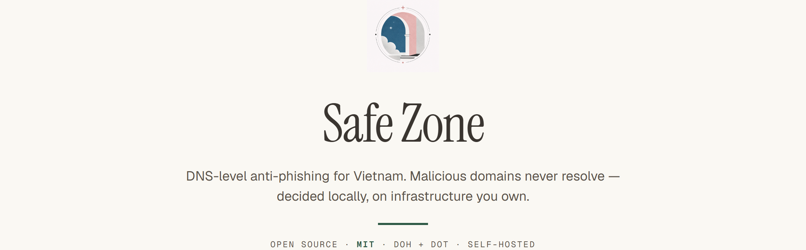
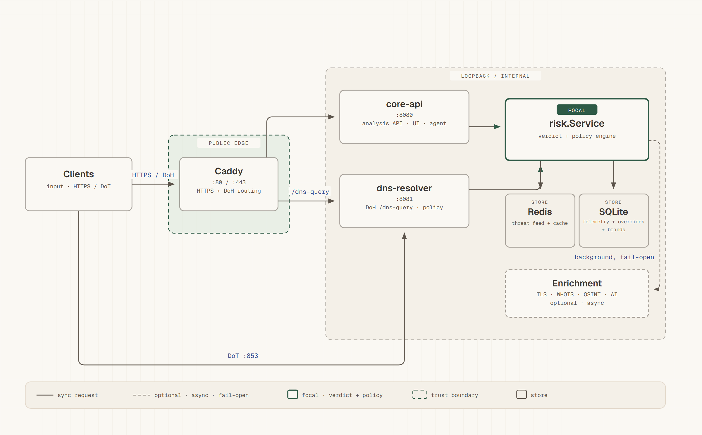
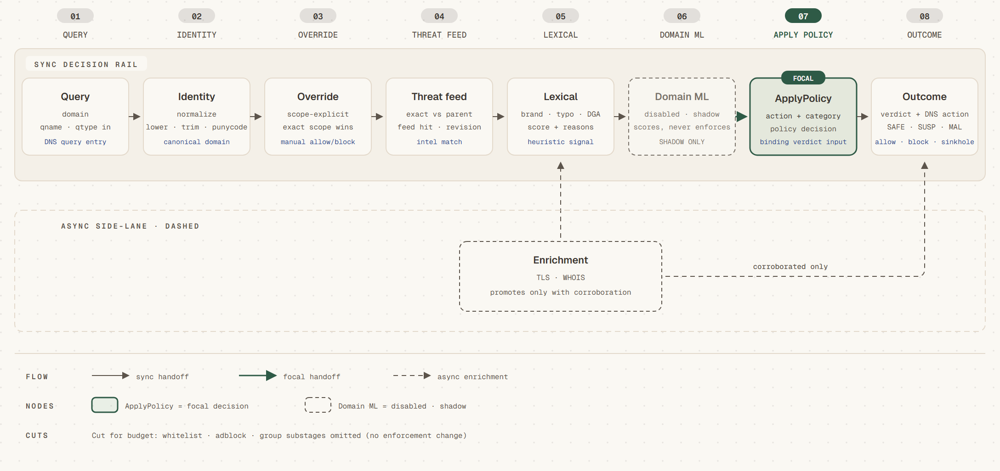
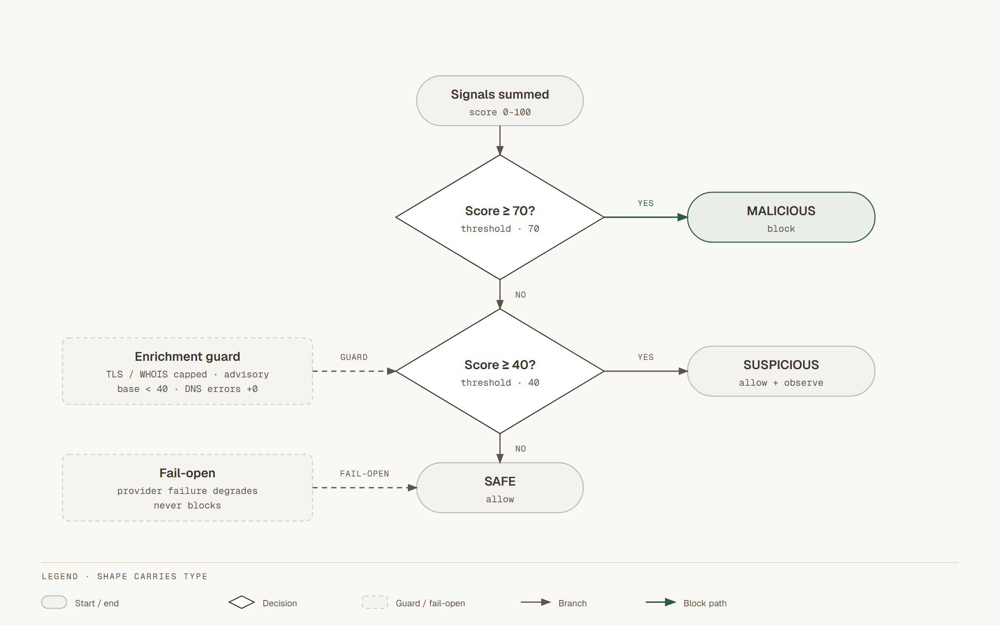

<div align="center">
  <h1>Safe Zone</h1>
  <p><strong>Lọc DNS tự vận hành cho tên miền phishing và giả mạo.</strong></p>
  <p>
    <a href="https://github.com/vmcchooky/safe-zone/actions/workflows/ci.yml"></a>
    <a href="https://github.com/vmcchooky/safe-zone/actions/workflows/security.yml"></a>
    <a href="https://go.dev/"></a>
    <a href="LICENSE"></a>
    <a href="docs/runbooks/production-edge.md"></a>
    <a href="docker-compose.production.yml"></a>
  </p>
  <p><a href="README.md">English</a> | Tiếng Việt</p>
</div>



Safe Zone là resolver DNS mã nguồn mở, tự vận hành, kèm giao diện vận hành
(operator console). Dự án chặn các tên miền khớp policy ngay tại lớp DNS, trước
khi client kết nối tới origin. Dự án dành cho operator muốn chạy dịch vụ trên
hạ tầng của mình, giữ dữ liệu policy tại local và chủ động chọn feed/enrichment
bên ngoài.

> **Bản phát hành có tag mới nhất:** [v1.10.21](https://github.com/vmcchooky/safe-zone/releases/tag/v1.10.21) (2026-10-21)<br>
> **Trạng thái production:** bản ứng viên phát hành (release candidate); xác
> thực trên VPS được cấp phát vẫn đang chờ.<br>
> **Trạng thái ML:** tùy chọn, mặc định tắt; URL-ML vẫn chỉ ở shadow.
>
> Nguồn chuẩn cho operator là
> [checklist hoàn thiện production](docs/production-completion-checklist.md).
> [Ghi chú phát hành v1.10.21](https://github.com/vmcchooky/safe-zone/releases/tag/v1.10.21)
> liệt kê bằng chứng và các kiểm tra còn được tạm hoãn.

<a id="contents"></a>
<a id="mục-lục"></a>
## Chọn hướng đi

| Tôi muốn... | Bắt đầu tại |
|---|---|
| Chạy demo local | [Bắt đầu nhanh](#quickstart) |
| Triển khai trên VPS | [Checklist production](#production-checklist) và [runbook edge](docs/runbooks/production-edge.md) |
| Hiểu cách xử lý dữ liệu | [Luồng dữ liệu và quyền riêng tư](#data-flow-and-privacy) |
| Vận hành dịch vụ | [Vận hành](#operations) |
| Kiểm tra mức sẵn sàng | [Trạng thái dự án](#project-status) |
| Đóng góp | [Đóng góp](#contributing) và [PR template](.github/pull_request_template.md) |

<a id="features"></a>
## Tính năng

Safe Zone kết hợp nhiều lớp sau một quyết định policy DNS:

- **Kết luận tên miền deterministic** — chấm điểm lexical cho typosquatting, lạm
  dụng thương hiệu, DGA/entropy và homoglyph IDN, không cần phụ thuộc bên ngoài
  cho quyết định cơ bản.
- **Threat intelligence trực tiếp** — đối chiếu feed cho tên miền đã biết là độc
  hại (malicious), kèm enrichment TLS/WHOIS nền chỉ nâng mức kết luận khi có
  bằng chứng xác nhận (corroboration).
- **Chặn theo policy** — sinkhole, NXDOMAIN, refused và null-IP, kèm CNAME
  uncloaking. Ads, tracker và telemetry là policy action, không bị gán nhãn
  malware.
- **Điều khiển cho operator** — dashboard React và API cho phân tích, override,
  nhóm client, báo cáo người dùng, metrics và sức khỏe feed.

| Dự án được thiết kế để | Dự án không được thiết kế để |
|---|---|
| Lọc câu trả lời DNS cho client cấu hình dùng Safe Zone. | Thay thế bảo vệ endpoint hoặc soi payload HTTPS tùy ý. |
| Cung cấp DoH, kèm DoT tùy chọn khi có certificate tin cậy. | Đảm bảo trang chặn HTTPS bình thường cho mọi tên miền bên thứ ba. |
| Kết hợp policy deterministic với feed/enrichment tùy chọn. | Đảm bảo coverage khi feed cũ, thiếu hoặc cấu hình kém. |
| Hiển thị trạng thái và bằng chứng cho operator. | Hứa zero false positive; mọi policy cần review và rollback. |

<a id="threat-intel-and-ml"></a>
### Threat intel và ML

- Production stack chạy `feed-syncd` và cần ít nhất một nguồn feed dùng được.
  Đặt `SAFE_ZONE_THREAT_FEED_SOURCE` và kiểm tra độ tươi trong
  `/v1/status`; tác vụ feed agent (opt-in) có thể dùng
  `SAFE_ZONE_AGENT_FEED_PRESET=production-free` hoặc `production-vn`. Xem
  [nguồn threat intelligence](docs/research/security/threat-intelligence-sources.md).
- Domain ML là tùy chọn, mặc định tắt. Shadow, canary và enforce đều có cổng;
  URL-ML vẫn shadow-only trong bản này. Xem
  [Safe Zone AI plan](docs/specs/safe-zone-ai-plan.md).
- Agent engine (audit, feed sync, OSINT, cảnh báo, refresh allow-list) là opt-in.
  Không bật lịch chạy production chỉ dựa trên ví dụ tối thiểu.

<details>
<summary>Thử một file feed local</summary>

```bash
go run ./cmd/feed-sync -source ./feeds/local.txt -dry-run
go run ./cmd/feed-sync -source ./feeds/local.txt -redis-addr localhost:6379
```

</details>

<a id="evaluation"></a>
### Đánh giá

```bash
mise run eval:decision
```

Lệnh chạy các corpus truth, contract và false-positive guard đã đóng băng. Trên
bộ guard 21 host hiện tại, cả 21 host đều được allow; đây là kiểm tra
regression, không phải FPR đại diện cho toàn bộ population. Nhãn cần nguồn gốc
(provenance), và `unknown` không bao giờ vào precision, recall hay FPR. Cổng đầy đủ:
[decision engine plan](docs/research/security/decision-engine-rebuttal-plan.md).

<a id="quickstart"></a>
## Bắt đầu nhanh

Yêu cầu: Go 1.26.10+ hoặc Docker. `mise` là tùy chọn cho bộ kiểm tra đầy đủ.
Các lệnh dưới đây dùng shell Unix; ghi chú Windows được thêm ở những chỗ khác
biệt.

### Docker (khuyến nghị cho lần chạy đầu)

```bash
git clone https://github.com/vmcchooky/safe-zone.git
cd safe-zone
cp .env.example .env
docker compose -f docker-compose.yml -f docker-compose.dev.yml up --build
```

Trên Windows PowerShell, dùng `Copy-Item .env.example .env`; `start.bat` là
launcher local được hỗ trợ. Dùng `curl.exe` cho các ví dụ `curl` trong README
này. Dev stack chỉ bind trên loopback.

Dashboard tại <http://localhost:8080/app/>, DoH tại
<http://localhost:8081/dns-query>.

### Go

Chạy mỗi lệnh trong một terminal riêng:

```bash
# Terminal 1 — API và dashboard tại http://localhost:8080/app/
go run ./cmd/core-api

# Terminal 2 — DNS policy và DoH tại http://localhost:8081/dns-query
go run ./cmd/dns-resolver
```

Lần chạy đầu, admin secret local được ghi vào `tmp/local_admin_secrets.txt`.

<a id="try-it"></a>
### Dùng thử

Truy vấn DoH (RFC 8484) và lưu response binary:

```bash
curl -s 'http://localhost:8081/dns-query?dns=EjQBAAABAAAAAAAAB2V4YW1wbGUDY29tAAABAAE' \
  -H 'accept: application/dns-message' \
  -o doh-response.bin
```

Kiểm tra `doh-response.bin` bằng `xxd` trên Linux/macOS hoặc `Format-Hex`
trong PowerShell.

Phân tích một tên miền nghi ngờ và xem policy mà lớp DNS sẽ thực thi:

```bash
curl "http://localhost:8080/v1/analyze?domain=secure-login-wallet-example.com"
curl "http://localhost:8081/v1/policy?domain=secure-login-wallet-example.com"
```

`/v1/status` và `/metrics` của core-api cần admin authentication. Admin key
local được sinh ở lần chạy đầu. Trên Linux/macOS:

```bash
export SAFE_ZONE_ADMIN_API_KEY=$(grep '^SAFE_ZONE_ADMIN_API_KEY=' tmp/local_admin_secrets.txt | cut -d= -f2)
curl -H "Authorization: Bearer $SAFE_ZONE_ADMIN_API_KEY" "http://localhost:8080/v1/status"
curl -H "Authorization: Bearer $SAFE_ZONE_ADMIN_API_KEY" "http://localhost:8080/metrics"
```

<details>
<summary>Windows PowerShell: đọc admin key đã sinh</summary>

```powershell
$env:SAFE_ZONE_ADMIN_API_KEY = (Get-Content tmp/local_admin_secrets.txt |
  Where-Object { $_ -like 'SAFE_ZONE_ADMIN_API_KEY=*' }) -replace '^SAFE_ZONE_ADMIN_API_KEY=', ''
curl.exe -H "Authorization: Bearer $env:SAFE_ZONE_ADMIN_API_KEY" "http://localhost:8080/v1/status"
```

</details>

`dns-resolver` metrics không cần authentication:

```bash
curl "http://localhost:8081/metrics"
```

Với strategy `sinkhole` mặc định và block-page IP truy cập được, HTTP request
tới tên miền bị chặn sẽ tới trang chặn và form báo cáo người dùng.
`https://$SAFE_ZONE_PUBLIC_HOST/block?domain=...` là trang giải thích HTTPS
chuẩn. HTTPS trực tiếp tới tên miền bên thứ ba bị chặn có thể hiện cảnh báo
certificate của chính tên miền đó trước; đây là giới hạn TLS của DNS filter
không thực hiện MITM, không phải block thất bại. Xem [Giới hạn](#limitations).

<a id="architecture"></a>
## Kiến trúc



`core-api` quản lý policy, override, report, feed và telemetry. `dns-resolver`
đánh giá policy và phục vụ DNS, DoH và DoT tùy chọn. SQLite là durable store;
Redis tùy chọn cho cache và feed state. Port nội bộ `8080` và `8081` chỉ loopback
ở production; port công khai là `80`, `443` và tùy chọn `853`. Xem
[bằng chứng xác thực edge (2026-09-20)](docs/deployment/edge-verification-2026-09-20.md).

<details>
<summary>Sơ đồ pipeline quyết định và chấm điểm</summary>

| Pipeline quyết định | Chấm điểm |
|---|---|
|  |  |

</details>

Sơ đồ khác: [deployment](docs/diagrams/deployment.png) ·
[DoH sequence](docs/diagrams/doh-sequence.png) ·
[defense layers](docs/diagrams/defense-layers.png). Bản HTML tương tác nằm cùng
thư mục PNG trong [`docs/diagrams/`](docs/diagrams/).

<a id="data-flow-and-privacy"></a>
## Luồng dữ liệu và quyền riêng tư

Safe Zone không yêu cầu control plane SaaS, và dữ liệu operator nằm trong
SQLite/Redis của bạn. Một số tính năng tùy chọn gửi request ra ngoài. Bảng mô tả
cấu hình ví dụ; kiểm tra `.env` trước khi deploy.

| Chức năng | Mặc định trong ví dụ | Dữ liệu ra ngoài | Cách kiểm soát |
|---|---|---|---|
| DNS forwarding | Pool DoH công khai: Cloudflare, Google, Quad9 và AdGuard (`SAFE_ZONE_UPSTREAM_DOH_URLS`) | Query được forward sẽ đi tới một trong các upstream DoH đã cấu hình. | Trỏ tới upstream của bạn hoặc provider tin cậy. |
| Threat feed | `feed-syncd` tải `SAFE_ZONE_THREAT_FEED_SOURCE` (URLhaus + OpenPhish trong ví dụ) | Feed provider thấy request từ host của bạn. | Dùng nguồn đã duyệt hoặc local; theo dõi độ tươi. |
| Danh sách adblock | Bật; tải StevenBlack hosts trong ví dụ | Nguồn host-list thấy request từ host của bạn. | Đặt `SAFE_ZONE_ADBLOCK_ENABLED=false` hoặc dùng nguồn của bạn. |
| TLS/WHOIS enrichment | Bật (`SAFE_ZONE_ENRICH_ENABLED=true`) | Kết nối outbound tới host đích và dịch vụ WHOIS. | Tắt hoặc giới hạn nếu không chấp nhận outbound. |
| OSINT | Bật trong ví dụ (`SAFE_ZONE_OSINT_ENABLED=true`) | Có thể truy vấn nguồn OSINT đã cấu hình. | Đặt `SAFE_ZONE_OSINT_ENABLED=false` và review nguồn. |
| AI/ML | ML tắt; AI provider tùy chọn (Gemini mặc định); agent tắt | Nếu bật, domain/context có thể được gửi tới provider; Ollama có thể chạy local. | Review `SAFE_ZONE_ML_MODE`, `SAFE_ZONE_AI_PROVIDER`, `SAFE_ZONE_AGENT_ENABLED`. |
| Dữ liệu operator | SQLite/Redis trên host | Mặc định không có telemetry ra ngoài; backup do operator kiểm soát. | Đặt retention và backup policy. |

Các mặc định này có nghĩa câu "không có dữ liệu rời VPS" không chính xác. Hãy
review bảng và tắt hoặc thay provider bạn không muốn dùng. Danh sách đầy đủ
trong [`.env.example`](.env.example).

<a id="deployment"></a>
<a id="triển-khai"></a>
<a id="production-checklist"></a>
## Checklist production

Đây là điểm bắt đầu; [checklist tiền phát hành](docs/runbooks/pre-release-checklist.md)
và [release gate](docs/runbooks/release-gate.md) là nguồn chuẩn.

- [ ] Đặt `SAFE_ZONE_ENV=production`. Compose production override ghim giá trị
      này.
- [ ] Cấu hình ít nhất một feed source, giữ `feed-syncd` chạy và kiểm tra độ tươi
      trong `/v1/status`. Production guard từ chối triển khai không có đường feed
      dùng được.
- [ ] Đặt admin secret mạnh qua `*_FILE`; không dùng giá trị dev.
- [ ] Đặt `SAFE_ZONE_WHITELIST_PATH` tới allow-list đã tuyển chọn, hoặc chủ động
      chọn chế độ DB-only đã được ghi tài liệu. Đường dẫn được cấu hình nhưng
      không đọc được là lỗi nghiêm trọng ở production.
- [ ] Giữ `SAFE_ZONE_AGENT_WHITELIST_ENABLED=false` cho tới khi diễn tập
      import, backup và rollback allow-list đã vượt qua.
- [ ] Chọn block strategy và đặt `SAFE_ZONE_BLOCK_PAGE_IP` IPv4 hợp lệ cho
      sinkhole. Smoke test strategy đã chọn.
- [ ] DoT là opt-in và mặc định tắt. Muốn public DoT, export cặp certificate
      tin cậy bằng `scripts/ops/export-dot-cert.sh`, đặt
      `SAFE_ZONE_DNS_DOT_ENABLED=true`, rồi deploy qua
      `scripts/ops/safe-zone.sh` để merge `ops/vps-edge/docker-compose.dot.yml`.
      Khởi động production với DoT bật nhưng thiếu cặp certificate hợp lệ sẽ
      thất bại.
- [ ] Xác nhận `/readyz` healthy và review `/v1/status` cho SQLite, Redis,
      allow-list và feed. SQLite bắt buộc; allow-list được cấu hình nhưng tải
      lỗi là lỗi nghiêm trọng ở production. Các dependency tùy chọn khác có thể
      được báo là degraded.
- [ ] Chạy diễn tập backup/restore, smoke test DoH/DoT/block-page bên ngoài và
      bằng chứng hiệu năng trước khi public.
- [ ] Review [Luồng dữ liệu và quyền riêng tư](#data-flow-and-privacy), approve
      hoặc tắt mọi provider bên ngoài.

Deploy production stack qua helper để build metadata và các overlay edge được
áp dụng:

```bash
scripts/ops/safe-zone.sh deploy
```

Trên Windows, dùng `pwsh ./scripts/ops/safe-zone.ps1 deploy`. Helper tự merge
`ops/vps-edge/docker-compose.host-edge.yml` khi
`SAFE_ZONE_DEPLOYMENT_TIER=shared-host-edge*`, và
`ops/vps-edge/docker-compose.dot.yml` khi `SAFE_ZONE_DNS_DOT_ENABLED=true`.
Không chạy `docker compose build` trực tiếp trên VPS; image sẽ thiếu
commit/version metadata.

Hướng dẫn edge đầy đủ (firewall, certificate DoT, DuckDNS, cron):
[production-edge.md](docs/runbooks/production-edge.md). Đây là ước lượng tài
nguyên tham khảo, không phải cam kết giá:
[Safe Zone OPEX estimate](docs/deployment/Safe_Zone_OPEX_Estimate.md).

<a id="configuration"></a>
## Cấu hình

| Biến | Mặc định | Tác dụng |
|---|---|---|
| `SAFE_ZONE_ENV` | `local` | Đặt `production` để bắt buộc admin secret mạnh và SQLite. |
| `SAFE_ZONE_REDIS_ADDR` | chưa đặt | Bật Redis cache và feed state, ví dụ `localhost:6379`. |
| `SAFE_ZONE_PUBLIC_HOST` | `safezone.example.com` trong ví dụ | Hostname công khai cho Caddy TLS và DoH. |
| `SAFE_ZONE_ADMIN_PASSWORD` / `SAFE_ZONE_ADMIN_API_KEY` | tự sinh local | Bắt buộc ở production, hoặc dùng đường dẫn `*_FILE`. |
| `SAFE_ZONE_WHITELIST_PATH` | trống (DB-only mode) | Nạp allow-list ban đầu (tùy chọn); đường dẫn được cấu hình nhưng không đọc được là lỗi nghiêm trọng ở production. |
| `SAFE_ZONE_THREAT_FEED_SOURCE` | URLhaus + OpenPhish trong `.env.example` | Nguồn feed cho `feed-syncd`; nhiều nguồn cách nhau bằng dấu phẩy. |
| `SAFE_ZONE_DNS_BLOCK_STRATEGY` | `sinkhole` | `sinkhole`, `nxdomain`, `refused` hoặc `nullip`. |
| `SAFE_ZONE_BLOCK_PAGE_IP` | `127.0.0.1` | IPv4 công khai cho trang chặn sinkhole; được validate lúc start. |
| `SAFE_ZONE_DNS_DOT_ENABLED` | `false` | DoT opt-in; cần overlay DoT và certificate/key tin cậy. |
| `SAFE_ZONE_ML_MODE` | `disabled` | Chế độ ML tùy chọn; URL-ML vẫn shadow-only. |
| `SAFE_ZONE_TELEMETRY_WRITE_PERCENT` | `100` local; `5` trong Compose production | Sample ghi telemetry. |
| `SAFE_ZONE_TRUSTED_PROXIES` | loopback | Các CIDR được phép đặt forwarded header; Compose thêm bridge Docker. |

Tham chiếu đầy đủ, default và comment nằm trong [`.env.example`](.env.example).
Secret nhận `VAR_FILE=./ops/secrets/name`; xem
[ops/secrets/README.md](ops/secrets/README.md). Admin có thể tinh chỉnh lexical
scoring không cần restart qua `GET/PUT /v1/config/analysis` (có revision, lan
truyền multi-node).

<a id="operations"></a>
## Vận hành

Helper hàng ngày:

```bash
pwsh ./scripts/ops/safe-zone.ps1 status
# Linux:
./scripts/ops/safe-zone.sh status
```

Các lệnh: `deploy`, `status`, `backup`, `restore`, `prune` và `feed-sync`.
Dùng helper nếu bạn đang dựa vào `SAFE_ZONE_SCRIPT_FEED_SYNC=0`; chạy
`docker compose up` trực tiếp sẽ tạo lại `feed-syncd`.

<a id="documentation-map"></a>
### Bản đồ tài liệu

| Lĩnh vực | Bắt đầu tại |
|---|---|
| Deploy và vận hành | [production-edge.md](docs/runbooks/production-edge.md) · [operator-onboarding.md](docs/runbooks/operator-onboarding.md) |
| Mức sẵn sàng production | [production-completion-checklist.md](docs/production-completion-checklist.md) · [release-gate.md](docs/runbooks/release-gate.md) |
| Backup và restore | [restore-drill.md](docs/runbooks/restore-drill.md) · [release-rollback.md](docs/runbooks/release-rollback.md) |
| Bảo mật | [threat-model.md](docs/security/threat-model.md) · [pre-release-security-checklist.md](docs/security/pre-release-security-checklist.md) |
| Threat intelligence | [threat-intelligence-sources.md](docs/research/security/threat-intelligence-sources.md) · [feed-staleness.md](docs/runbooks/feed-staleness.md) |
| ML | [safe-zone-ai-plan.md](docs/specs/safe-zone-ai-plan.md) · [ml-canary-rollout.md](docs/runbooks/ml-canary-rollout.md) |
| Đánh giá | [decision-engine-rebuttal-plan.md](docs/research/security/decision-engine-rebuttal-plan.md) |
| Lịch sử phát hành | [Releases](https://github.com/vmcchooky/safe-zone/releases) · [round-5 manifest](docs/deployment/release-manifest-r5.md) (lịch sử) |

<a id="project-status"></a>
## Trạng thái dự án

Safe Zone là bản ứng viên phát hành (release candidate). Tag mới nhất là
[v1.10.21](https://github.com/vmcchooky/safe-zone/releases/tag/v1.10.21)
(2026-10-21), và commit được gắn tag đã vượt qua các cổng phát hành. Xác thực
trên VPS staging và production, gồm smoke test DoH/DoT/block-page, diễn tập khôi
phục và bằng chứng hiệu năng, vẫn đang chờ;
[ghi chú phát hành v1.10.21](https://github.com/vmcchooky/safe-zone/releases/tag/v1.10.21)
ghi các miễn trừ (waiver) này.

ML là tùy chọn và mặc định tắt. URL-ML vẫn shadow-only và không phải enforcement
signal trong bản này.

- Checklist operator: [production-completion-checklist.md](docs/production-completion-checklist.md)
- Release gate: [release-gate.md](docs/runbooks/release-gate.md)
- Bằng chứng phát hành: [v1.10.21](https://github.com/vmcchooky/safe-zone/releases/tag/v1.10.21)
- Round-5 manifest lịch sử: [release-manifest-r5.md](docs/deployment/release-manifest-r5.md) (2026-09-20; giữ để tham khảo lịch sử)

<a id="limitations"></a>
### Giới hạn

- Lọc DNS chỉ áp dụng cho client cấu hình dùng Safe Zone; đây không phải bảo vệ
  endpoint.
- Safe Zone không can thiệp TLS. HTTPS trực tiếp tới tên miền bên thứ ba bị chặn
  có thể hiện cảnh báo certificate của chính tên miền đó trước khi tới được
  trang chặn.
- Mức bảo vệ phụ thuộc coverage, độ tươi của feed và policy của operator. Hãy
  theo dõi trạng thái feed thay vì mặc định feed luôn mới.
- ML là tùy chọn và mặc định tắt; ML không thay thế review policy hay theo dõi
  feed.
- Kiểm tra lúc khởi động là fail-closed cho các thiết lập production bắt buộc.
  Hành vi runtime của các dependency tùy chọn có thể bị degraded hoặc fail-open
  tùy tính năng, nên resolver đang chạy không chứng minh được feed, enrichment
  hay allow-list đang khỏe mạnh. Theo dõi `/v1/status` và `/readyz`.
- Triển khai Compose là single-node, không phải thiết kế có tính sẵn sàng cao
  (HA). Backup và diễn tập khôi phục vẫn là trách nhiệm của operator.
- Bộ false-positive guard 21 host là kiểm tra regression, không phải bảo đảm FPR
  cho toàn bộ population.
- Các provider bên ngoài tùy chọn (upstream DoH, feed, adblock list, OSINT,
  TLS/WHOIS enrichment và AI) có thể nhận dữ liệu tùy cấu hình.
- Xác thực trên VPS staging và production, diễn tập khôi phục và diễn tập hiệu
  năng vẫn đang chờ; xem [Trạng thái dự án](#project-status).

<a id="security"></a>
## Bảo mật

- Threat model và các release blocker:
  [docs/security/threat-model.md](docs/security/threat-model.md)
- Checklist bảo mật tiền phát hành:
  [docs/security/pre-release-security-checklist.md](docs/security/pre-release-security-checklist.md)
- Phát hiện lỗ hổng? **Đừng mở issue công khai.** Liên hệ maintainer riêng qua
  trang dự án: <https://www.quorix.io.vn/projects/safe-zone/>. Ghi rõ tag hoặc
  commit bị ảnh hưởng, bước tái hiện và impact; không gửi secret thật hoặc dữ
  liệu khách hàng.
- Xử lý và xoay secret:
  [docs/runbooks/credential-rotation.md](docs/runbooks/credential-rotation.md)

<a id="contributing"></a>
## Đóng góp

Chúng tôi chào đón issue và pull request. Vui lòng đọc
[PR template](.github/pull_request_template.md) (kèm checklist chi phí) và chạy
`mise run ci` trước khi push. CI gồm Go lint, test, race test, React typecheck,
Playwright end-to-end, `gosec`, `govulncheck`, npm audit, secret scan và Docker
build.

Mọi khẳng định trong PR cần bằng chứng: test đã chạy, số đã đo và docs đã cập
nhật. Giữ `README.md` và `README.vi.md` đồng bộ.

<a id="credits"></a>
## Ghi nhận

Các công cụ phát triển và review đã dùng cho dự án:

- [Codex](https://github.com/codex)
- [OpenCode](https://opencode.ai)
- [Kiro](https://kiro.dev)
- [Google Antigravity](https://github.com/google-antigravity)
- [Z.ai](https://github.com/zai-org)
- [dependabot\[bot\]](https://github.com/apps/dependabot) — cập nhật dependency

<a id="license"></a>
## Giấy phép

MIT — xem [LICENSE](LICENSE).
